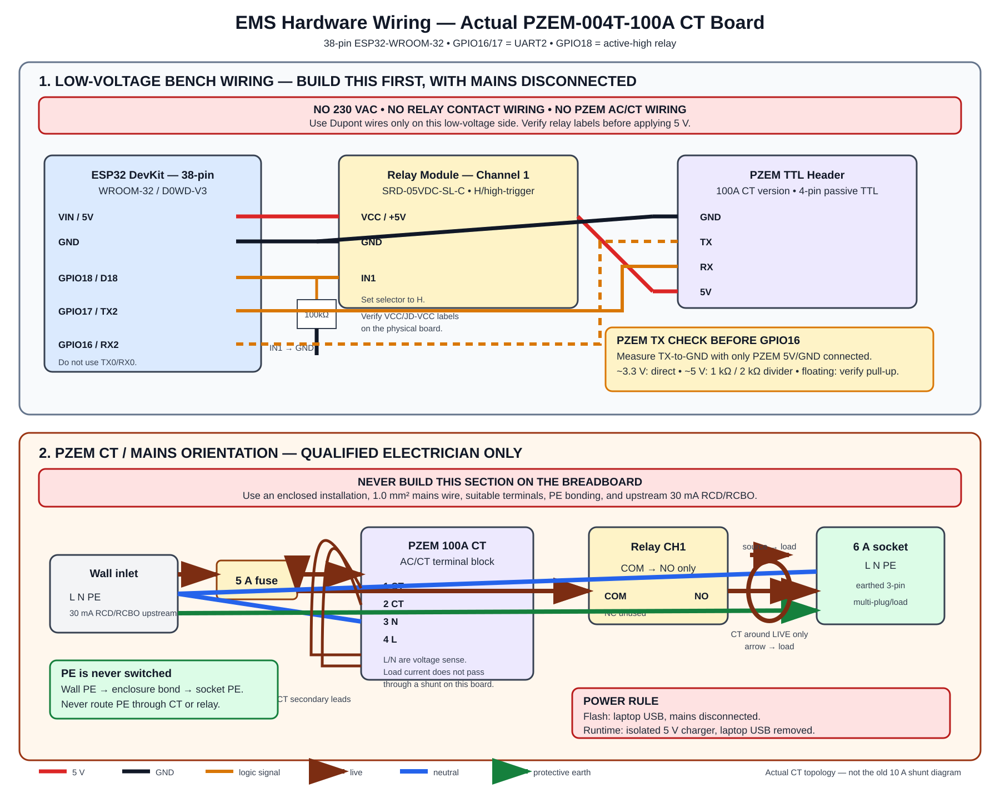
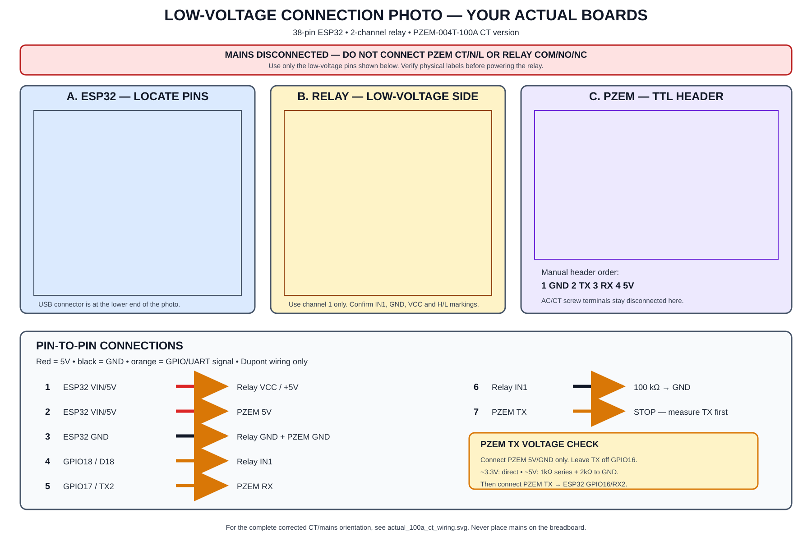

# Actual Hardware Wiring — ESP32 DevKit V1 (30-pin) + PZEM-004T-100A CT





**Applies to:** the hardware shown for this bench: ESP32 DevKit V1 (30-pin),
PZEM-004T-100A(V4.0) meter with external CT, and 2-channel active-LOW opto-isolated relay module.
- Relay 1 (laptop charger): IN1 = GPIO 26
- Relay 2 (phone charger): IN2 = GPIO 27

**Status:** the low-voltage pin map below is the wiring target. Mains wiring is
still blocked until the relay labels/trigger mode, CT polarity, enclosure,
protective earth, RCD/RCBO, fuse holder, and isolation are physically checked.

> **Never put 230 VAC on the breadboard or in Dupont jumpers.** The diagrams in
> Sections 1–4 are the only part that may be assembled for the first bench test.

## 1. Exact low-voltage pin-to-pin map

Use the labels printed on the boards. Do not use GPIO 12 (MTDI strapping pin). Do not use GPIO 16/17 for anything else.

| ESP32 DevKit V1 Pin | Connect to | Wire / condition |
|---|---|---|
| `3V3` | PZEM TTL `3V3` / `VCC` | 3.3 V logic power |
| `VIN` / `5V` | Relay `JD-VCC` | 5 V coil supply (jumper removed between VCC and JD-VCC) |
| `GND` | Relay module `GND` | Shared low-voltage ground |
| `GND` | PZEM TTL `GND` | Shared low-voltage ground |
| `GPIO25` | Relay `VCC` | 3.3 V source for opto LEDs (driven HIGH in setup, feeds a few mA) |
| `GPIO26` | Relay `IN1` | Active-LOW control for Relay 1 (Laptop Charger) |
| `GPIO27` | Relay `IN2` | Active-LOW control for Relay 2 (Phone Charger) |
| `GPIO17` / `TX2` | PZEM TTL `RX` | UART2 transmit from ESP32 to PZEM RX (9600 baud, 8N1) |
| `GPIO16` / `RX2` | PZEM TTL `TX` | UART2 receive from PZEM TX to ESP32 RX |

```text
                         LOW-VOLTAGE BENCH ONLY

 ESP32 3V3     ──────────────────────── PZEM TTL 3V3
 ESP32 5V/VIN  ──────────────────────── Relay JD-VCC (jumper removed)

 ESP32 GND     ───────────────┬──────── Relay GND
                               └──────── PZEM TTL GND

 ESP32 GPIO25  ──────────────────────── Relay VCC (opto LED source)
 ESP32 GPIO26  ──────────────────────── Relay IN1 (laptop charger)
 ESP32 GPIO27  ──────────────────────── Relay IN2 (phone charger)

 ESP32 GPIO17 / TX2 ─────────────────── PZEM RX
 ESP32 GPIO16 / RX2 ◄────────────────── PZEM TX

 PZEM AC/CT screw terminals: DISCONNECTED during this bench stage.
 Relay COM/NO/NC contacts:   DISCONNECTED during this bench stage.
```

### Relay-board identity & active-LOW operation

The 2-channel relay module uses **ACTIVE-LOW** logic:
- `LOW` = relay ON (energised)
- `HIGH` = relay OFF (de-energised)

Relay module opto-LED VCC is powered from `GPIO25` as a 3.3 V source.
Relay coil supply (`JD-VCC`) is connected to external 5 V (`VIN`), with the board jumper removed between `VCC` and `JD-VCC`.

**Strict startup order in firmware:**
1. Configure `RELAY1_PIN` (GPIO 26) and `RELAY2_PIN` (GPIO 27) as outputs and write `RELAY_OFF` (`HIGH`).
2. THEN configure `RELAY_VCC_PIN` (GPIO 25) as output and write `HIGH`.
3. Delay ~100 ms, then initialize PZEM on `Serial2` (GPIO 16/17, 9600 baud).
4. Relays stay OFF through boot and reset.

All relay switching goes through `setRelay(channel, bool on)` applying the active-LOW mapping. Safe-state function `allRelaysOff()` writes HIGH to GPIO 26 and 27 on any fatal error, watchdog trip, comms loss, or restart.

| Firmware call | Pin Level | Relay result |
|---|---|---|
| `setRelay(ch, false)` | `HIGH` (3.3 V) | Channel open (OFF) |
| `setRelay(ch, true)` | `LOW` (0 V) | Channel closed (ON) |
| Reset / boot sequence | Initialized `HIGH` before `GPIO25` VCC driven `HIGH` | Relays remain open (OFF) |

Do not connect any relay contact terminal to the breadboard or to mains for the
first test. Verify `COM–NO` with a continuity meter while toggling the relay.

## 2. PZEM TTL header

Use the manual's header order, not a wire-color assumption. The supplied
PZEM-004T-100A(V4.0)-type board header is:

| PZEM TTL header position | Function | ESP32 connection |
|---:|---|---|
| 1 | `GND` | Any ESP32 `GND` |
| 2 | `TX` | ESP32 `GPIO16/RX2` |
| 3 | `RX` | ESP32 `GPIO17/TX2` |
| 4 | `3V3` / `VCC` | ESP32 `3V3` |

The UART is crossed intentionally: PZEM `TX → ESP32 RX`, and ESP32 `TX → PZEM
RX`. Do not use ESP32 `TX0/RX0`; those pins are reserved for USB flashing and
serial logging. Do not use GPIO 12 (strapping pin). Do not use GPIO 16/17 for anything else.
serial logging.

## 3. Mandatory PZEM-TX voltage check

The ESP32 GPIO maximum is 3.6 V. Do this with the PZEM AC/CT terminals still
disconnected:

1. Power only the ESP32 and PZEM TTL side from the low-voltage 5 V rail.
2. Connect PZEM `5V` and `GND`; leave PZEM `TX` disconnected from GPIO16.
3. Measure PZEM `TX` to PZEM `GND` with a DC multimeter.
4. Use exactly one result:

| Measured PZEM TX | Connection to GPIO16 |
|---|---|
| Approximately 3.3 V | Direct connection is acceptable after confirming the reading is stable |
| Floating / high impedance | Do not guess; use the documented pull-up arrangement and recheck |
| Approximately 5 V | **Never direct-connect.** Use a divider: `TX → 1 kΩ → GPIO16`, and `GPIO16 → 2 kΩ → GND` |

```text
For a measured 5 V PZEM TX:

 PZEM TX ──[ 1 kΩ ]──┬──── ESP32 GPIO16 / RX2
                     │
                  [ 2 kΩ ]
                     │
                    GND
```

Do not connect PZEM `TX` directly to GPIO16 before this measurement.

## 4. PZEM-004T-100A(V4.0) AC/CT terminals

This is the important difference from the project's old 10 A direct-connect
diagram. On the actual CT meter, the load conductor does **not** pass through a
PZEM shunt. The external CT measures one conductor.

Using the manual's stated top-to-bottom order:

| PZEM AC/CT terminal | Function | Connection |
|---:|---|---|
| 1 | `CT` | One CT secondary lead |
| 2 | `CT` | The other CT secondary lead |
| 3 | `N` | Neutral voltage-sense connection; mains work only |
| 4 | `L` | Fused line voltage-sense connection; mains work only |

The CT must surround **one conductor only**, the live conductor. Do not put a
complete two-wire cable through the CT because live and neutral cancel. If the
CT has an arrow, orient it from source/inlet toward the socket/load. Confirm
polarity with a qualified person and a controlled reference load; a reversed CT
can produce a wrong-sign or invalid power result.

```text
 CT terminal 1 ───────── CT secondary lead 1
 CT terminal 2 ───────── CT secondary lead 2

 CT clamp around ONLY this conductor:
       relay NO ────────( CT around live wire )────── socket L
                          arrow → socket/load

 PZEM terminal 3 (N) ─── voltage-sense N
 PZEM terminal 4 (L) ─── fused voltage-sense L
```

The PZEM `L` and `N` terminals are voltage-sense/mains-side connections; they
are not an `L in` / `L out` current path for this 100 A CT version.

## 5. Mains-side topology — orientation only, not a self-build instruction

Have a qualified electrician make and test this inside a closed, flame-rated
enclosure. The exact board labels and CT direction must be checked against the
physical unit before energizing it.

```text
 Wall Live (L)
      │
      ├── 5 A fuse ──┬── PZEM L voltage sense
      │              │
      │          Relay COM ── Relay NO ──(CT around this live wire)── Socket L
      │
 Wall Neutral (N) ───┬── PZEM N voltage sense
                     └──────────────────────────────────────────── Socket N

 Wall PE ─────────── PE barrier / enclosure bond ───────────────── Socket PE
                     (protective earth is never switched and does not pass
                      through the CT or relay contacts)
```

This topology keeps PZEM voltage present when the relay opens, while the CT
reads zero current after the socket is disconnected. Do not reuse the old
10 A diagram showing `L in → PZEM → L out`; that is the wrong current topology
for this actual 100 A CT board.

Required before any mains energization:

- upstream verified 30 mA RCD/RCBO;
- 5 A fuse and suitable holder;
- 1.0 mm² mains conductors and screw terminals, never Dupont wires;
- closed enclosure, strain relief, creepage/clearance, and enclosure PE bond;
- relay `COM/NO` continuity and open-at-boot verified with mains disconnected;
- CT terminals, CT orientation, PZEM `L/N`, and relay labels checked by a
  qualified person;
- laptop USB removed before mains is connected.

## 6. Power-mode rule

| Mode | Power | Mains |
|---|---|---|
| Flash / bench | Laptop USB → ESP32 USB; VIN supplies the low-voltage modules | Fully disconnected |
| Runtime | Isolated/BIS-marked 5 V 2 A charger → USB screw-terminal breakout → 5 V/GND rail | Laptop USB removed |

Never use laptop USB and a live mains-connected PZEM assembly together.

## 7. First safe assembly order

1. ESP32 alone on laptop USB; confirm serial output and GPIO18 LOW during reset.
2. Add the relay low-voltage connections and 100 kΩ pull-down; verify open at
   boot and `COM–NO` continuity changes with a meter.
3. Power the PZEM TTL side only; perform the TX voltage check.
4. Add the PZEM UART connection, using the divider if required.
5. Leave all PZEM AC/CT terminals and relay contact terminals disconnected.
6. Only after the low-voltage checks pass should a qualified electrician review
   the CT/mains enclosure wiring.

For dry relay continuity, use the dedicated PlatformIO `bench` environment and
its `DRY_ON`/`DRY_OFF` serial commands with relay contacts disconnected. Do not
use production MQTT `ON` for a no-mains test; production firmware requires a
valid 80–260 V PZEM frame before it can close the relay.

## References

- Firmware pins: `firmware/esp32_node/src/main.cpp:82-95`.
- PZEM-004T manual/datasheet mirror: <https://arduino.ua/files/PZEM-004T-V3_0-Datasheet-User-Manual.pdf>
- Additional datasheet mirror: <https://www.mantech.co.za/Datasheets/Products/pzem-004t-250109a.pdf>
- Project safety gates: [`SAFETY_GATES.md`](./SAFETY_GATES.md) and
  [`VALIDATION_STATUS.md`](./VALIDATION_STATUS.md).
